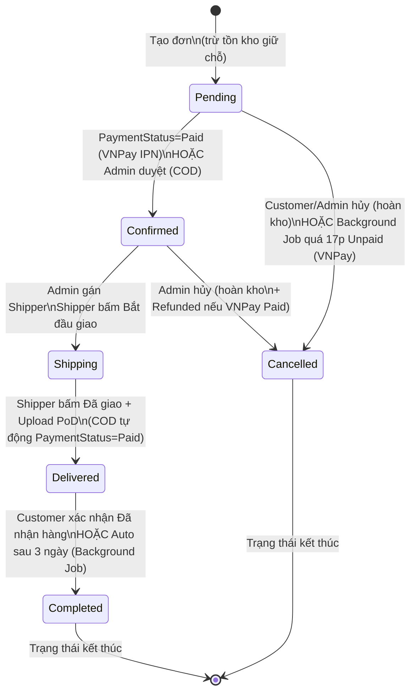
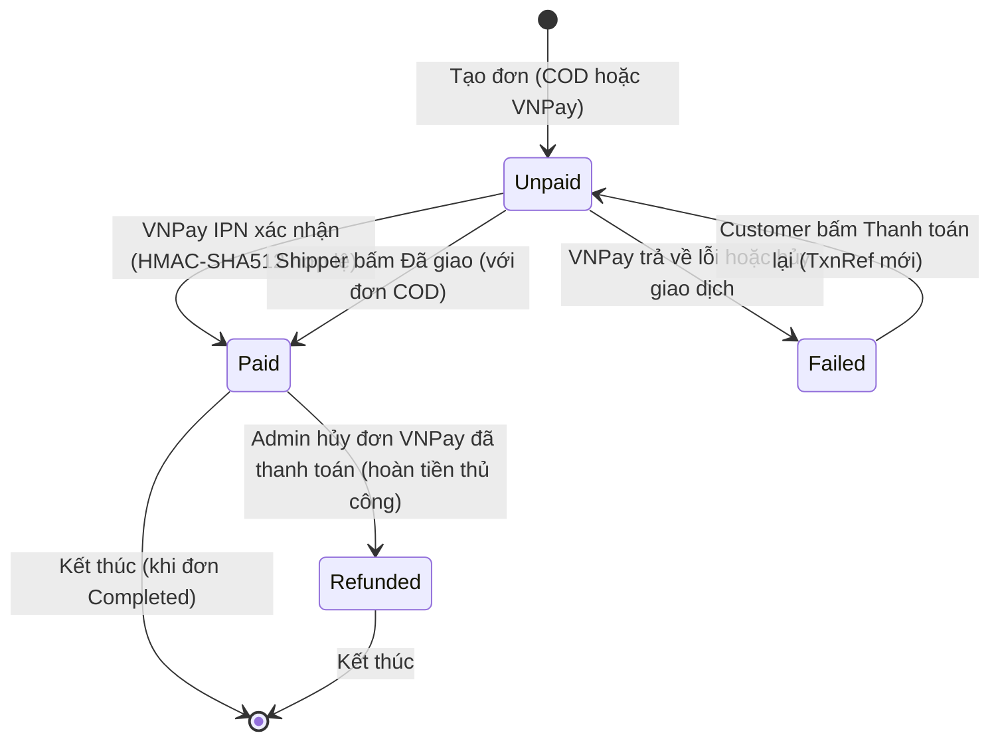
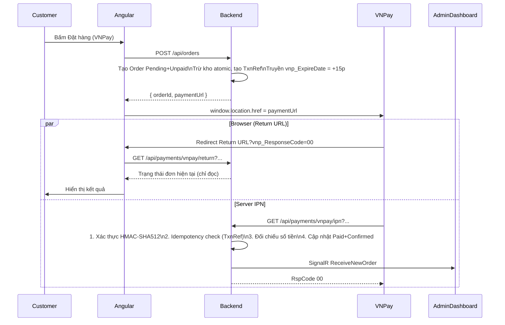

# 📐 Business Rules — VoltTech Store E-Commerce

> **Mô hình:** Single-Vendor E-Commerce (B2C)  
> **Phiên bản:** MVP 1.0 + Shipper Extension  
> **Cập nhật:** 2026-11-22  
> **Tech Stack:** ASP.NET Core · Angular · PostgreSQL · VNPay · SignalR · Cloudinary (PoD)

---

## 1. 👥 Ma trận phân quyền (Role & Permission Matrix)

### Roles

| Role | Mô tả | Lưu trong bảng `Users` |
|------|-------|------------------------|
| **Guest** | Khách vãng lai, chưa đăng nhập | Không |
| **Customer** | Khách hàng đã đăng ký và đăng nhập | Có |
| **Shipper** | Nhân viên giao hàng (mô hình tự giao) — được Admin gán đơn | Có |
| **Admin** | Quản trị viên hệ thống | Có |

### Permission Matrix

| Chức năng | Guest | Customer | Shipper | Admin |
|-----------|-------|----------|---------|-------|
| Xem, tìm kiếm, lọc sản phẩm | ✅ | ✅ | ❌ | ✅ |
| Xem chi tiết sản phẩm | ✅ | ✅ | ❌ | ✅ |
| Thêm/sửa/xóa giỏ hàng | ✅ local | ✅ DB | ❌ | ❌ |
| Đặt hàng & thanh toán (COD / VNPay) | ❌ | ✅ | ❌ | ❌ |
| Hủy đơn hàng | ❌ | ✅ Khi `Pending` và `PaymentStatus ≠ Paid` (`Unpaid` hoặc `Failed`) | ❌ | ✅ Khi `Pending` hoặc `Confirmed` (đơn VNPay đã `Paid` chuyển sang `Refunded` — hoàn tiền thủ công) |
| Thanh toán lại (VNPay) | ❌ | ✅ Khi `Pending` + `PaymentStatus ≠ Paid` + còn trong 15 phút | ❌ | ❌ |
| Xem lịch sử đơn hàng | ❌ | ✅ Chỉ đơn của mình | ✅ Chỉ đơn được gán | ✅ Toàn hệ thống |
| Xem danh sách đơn được gán | ❌ | ❌ | ✅ | ✅ |
| Cập nhật `Shipping` | ❌ | ❌ | ✅ Đơn được gán cho mình | ✅ |
| Cập nhật `Delivered` + upload PoD | ❌ | ❌ | ✅ Đơn đang giao của mình | ✅ |
| Xác nhận `Completed` | ❌ | ✅ Đơn của mình ở trạng thái `Delivered` | ❌ | ✅ |
| Gán Shipper cho đơn | ❌ | ❌ | ❌ | ✅ |
| CRUD Danh mục, Sản phẩm | ❌ | ❌ | ❌ | ✅ |
| Upload ảnh sản phẩm Cloudinary | ❌ | ❌ | ❌ | ✅ |
| Upload ảnh PoD Cloudinary | ❌ | ❌ | ✅ | ✅ |
| Xem thống kê doanh thu | ❌ | ❌ | ❌ | ✅ |
| Nhận thông báo SignalR | ❌ | ✅ Đơn của mình (`OrderDelivered`) | ✅ Đơn được gán (`OrderAssigned`) | ✅ Toàn hệ thống (`ReceiveNewOrder`) |

### Triển khai phân quyền

```csharp
// Backend — Role-based Authorization
[Authorize(Roles = "Admin")]            // Chỉ Admin
[Authorize(Roles = "Customer")]          // Chỉ Customer
[Authorize(Roles = "Shipper")]           // Chỉ Shipper
[Authorize(Roles = "Admin,Shipper")]     // Admin hoặc Shipper
[Authorize]                              // Mọi role đã đăng nhập

// Frontend — Route Guards
AuthGuard    → chặn Guest truy cập /checkout, /account/*
AdminGuard   → chặn non-Admin truy cập /admin/*
ShipperGuard → chặn non-Shipper truy cập /shipper/*
```

---

## 2. 🔄 State Machine

### 2.1 OrderStatus — Vòng đời đơn hàng



**Luật chuyển đổi hợp lệ:**

| Từ | Sang | Điều kiện | Actor |
|----|------|-----------|-------|
| `Pending` | `Confirmed` | `PaymentStatus=Paid` (auto VNPay IPN) hoặc Admin duyệt (COD) | System / Admin |
| `Pending` | `Cancelled` | Customer hủy (`PaymentStatus ≠ Paid`), Admin hủy, hoặc VNPay quá hạn 17 phút (hoàn kho) | Customer / Admin / Background Worker |
| `Confirmed` | `Shipping` | Đơn đã gán `ShipperId` + Shipper bấm bắt đầu giao | Shipper (đơn được gán) |
| `Confirmed` | `Cancelled` | Admin hủy trước khi giao (hoàn kho; nếu VNPay đã `Paid` → chuyển `PaymentStatus=Refunded`) | Admin |
| `Shipping` | `Delivered` | Shipper bấm "Đã giao" + upload 1–5 ảnh PoD bắt buộc (nếu COD → tự cập nhật `PaymentStatus=Paid`) | Shipper |
| `Delivered` | `Completed` | Customer xác nhận đã nhận hàng | Customer |
| `Delivered` | `Completed` | Tự động sau 3 ngày kể từ `DeliveredAt` không có phản hồi | Background Worker |

**Luật CẤM (ném exception):**

- `Shipping` → `Pending` / `Confirmed` ❌ (không thể quay lui)
- `Delivered` → `Shipping` / `Confirmed` / `Pending` ❌ (không thể quay lui)
- `Completed` → bất kỳ ❌ (trạng thái kết thúc)
- `Cancelled` → bất kỳ ❌ (trạng thái kết thúc)
- Shipper cập nhật đơn **không được gán cho mình** ❌ → HTTP 403

```csharp
// Triển khai trong Order entity — Domain Layer
public void TransitionTo(OrderStatus newStatus)
{
    var allowed = (OrderStatus, newStatus) switch
    {
        (OrderStatus.Pending,   OrderStatus.Confirmed)  => true,
        (OrderStatus.Pending,   OrderStatus.Cancelled)  => true,
        (OrderStatus.Confirmed, OrderStatus.Shipping)   => true,
        (OrderStatus.Confirmed, OrderStatus.Cancelled)  => true,
        (OrderStatus.Shipping,  OrderStatus.Delivered)  => true,
        (OrderStatus.Delivered, OrderStatus.Completed)  => true,
        _ => false
    };
    if (!allowed)
        throw new InvalidOperationException(
            $"Cannot transition from {OrderStatus} to {newStatus}");
    OrderStatus = newStatus;
}
```

> [!IMPORTANT]
> **Shipper chỉ được cập nhật đơn được Admin gán cho mình.** Backend phải kiểm tra `Order.ShipperId == currentUserId` trước khi cho phép chuyển trạng thái.

---

### 2.2 PaymentStatus — Trạng thái thanh toán



> [!IMPORTANT]
> Với **VNPay**, `PaymentStatus = Paid` **CHỈ** được cập nhật bởi IPN endpoint (`GET`, Server-to-Server) — tuyệt đối không cập nhật ở Return URL. Với **COD**, `PaymentStatus = Paid` tự động cập nhật khi Shipper chuyển đơn sang `Delivered`.

**Mối liên hệ 2 State Machine + SignalR + Shipper flow:**

```text
[Nhánh COD]
  Tạo đơn (Pending + Unpaid)
    → SignalR: ReceiveNewOrder → Admin Dashboard (Group "Admins")
    → Admin duyệt: Pending → Confirmed

[Nhánh VNPay]
  Tạo đơn (Pending + Unpaid, ExpiresAt = +15p)
    → VNPay IPN (GET): PaymentStatus = Paid, OrderStatus = Confirmed
    → SignalR: ReceiveNewOrder → Admin Dashboard (Group "Admins")

[Luồng giao vận chung sau khi Confirmed]
  Admin gán ShipperId → SignalR: OrderAssigned → Shipper (Clients.User)
    → Shipper: Confirmed → Shipping (bấm Bắt đầu giao)
    → Shipper: Shipping → Delivered + upload PoD (nếu COD → tự động PaymentStatus = Paid)
    → SignalR: OrderDelivered → Customer (Clients.User)
    → Customer: Delivered → Completed (HOẶC Auto-Complete sau 3 ngày)
```

---

## 3. 📏 Business Rules cốt lõi

### BR-01 — Giữ chỗ tồn kho, Chống bán âm kho & Hoàn kho khi hủy đơn

**Mô tả:** Tồn kho được trừ **ngay thời điểm tạo đơn** ở trạng thái `Pending` (áp dụng cho cả COD và VNPay).

**Thời hạn giữ chỗ (chỉ áp dụng cho đơn VNPay):**
- Khi sinh URL thanh toán, truyền tham số `vnp_ExpireDate = CreatedAt + 15 phút` sang cổng VNPay (VNPay tự khóa thanh toán sau phút 15).
- Lưu `ExpiresAt = CreatedAt + 15 phút` vào DB; Background Worker cộng thêm **2 phút đệm** (quét từ phút thứ 17) để tránh xung đột với IPN gửi trễ ở phút 15.

**Background Worker logic (`OrderExpirationService`):**

```text
Mỗi 1 phút, quét:
  Orders WHERE OrderStatus = 'Pending'
           AND PaymentMethod = 'VNPay'
           AND PaymentStatus != 'Paid'
           AND ExpiresAt IS NOT NULL
           AND ExpiresAt + INTERVAL '2 minutes' < UtcNow
  → Chuyển sang Cancelled
  → Cộng trả lại StockQuantity cho từng sản phẩm (trong cùng 1 Transaction)
```

**Hoàn tồn kho khi hủy thủ công:** Mọi thao tác hủy đơn hợp lệ từ Customer hoặc Admin (`Pending` / `Confirmed` → `Cancelled`) bắt buộc phải cộng trả lại `StockQuantity` cho từng `OrderDetail` trong cùng 1 Database Transaction.

**Atomic Update chống Overselling:**

```sql
-- Chạy trong Database Transaction
UPDATE "Products"
SET "StockQuantity" = "StockQuantity" - @qty
WHERE "Id" = @id AND "StockQuantity" >= @qty;
-- affected = 0 → Rollback + HTTP 409 "Hết hàng"
```

> [!CAUTION]
> Nghiêm cấm pattern check-then-act (kiểm tra rồi mới trừ riêng lẻ). Phải dùng Atomic Update hoặc Optimistic Concurrency (`xmin`) trong cùng 1 Transaction.

---

### BR-02 — Lưu cứng giá mua (Price Snapshot)

**Mô tả:** Giá sản phẩm tại thời điểm đặt hàng phải lưu cứng vào `OrderDetail.UnitPriceAtPurchase`.

```csharp
var detail = new OrderDetail
{
    ProductId            = item.ProductId,
    ProductNameSnapshot  = product.Name,                             // Snapshot tên
    UnitPriceAtPurchase  = product.DiscountPrice ?? product.Price,   // Snapshot giá
    Quantity             = item.Quantity
};

// Tính tổng từ DB, KHÔNG tin giá từ Client
order.TotalAmount = orderDetails.Sum(d => d.UnitPriceAtPurchase * d.Quantity);
```

---

### BR-03 — Gộp giỏ hàng (Cart Merging)

**Trigger:** Guest đăng nhập thành Customer, có sẵn sản phẩm trong `localStorage`.

**Luật gộp:**

| Tình huống | Xử lý |
|------------|-------|
| Sản phẩm chỉ có trong `localStorage` | Thêm vào giỏ Server |
| Sản phẩm chỉ có trong giỏ Server | Giữ nguyên |
| Sản phẩm trùng ID (cả 2 nơi) | Cộng dồn, **tối đa = `StockQuantity` hiện tại** |
| Sản phẩm đã hết hàng hoặc bị xóa mềm | Không thêm, bỏ qua |

**Luồng:**

```text
1. Đăng nhập thành công → nhận JWT
2. Angular CartService → POST /api/cart/merge { items: [...localStorage items] }
3. Backend merge (trong Transaction)
4. Backend trả về giỏ đã gộp
5. Angular: xóa localStorage, cập nhật CartService Signal
```

---

### BR-04 — Xác thực thanh toán chuẩn Production (VNPay IPN)

**Luồng VNPay:**



**Quy tắc IPN endpoint (`[HttpGet]`):**

1. Xác thực chữ ký `HMAC-SHA512` từ Query String → sai: trả `RspCode: "97"`, dừng
2. Idempotency: `TxnRef` đã `IsProcessed = true` → trả `RspCode: "02"`, dừng
3. Đối chiếu số tiền: `vnp_Amount / 100` phải khớp `Order.TotalAmount` → lệch: trả `RspCode: "04"`, dừng
4. Cập nhật `PaymentStatus = Paid`, `OrderStatus = Confirmed`, đánh dấu `IsProcessed = true` (trong Transaction)
5. Gửi SignalR `ReceiveNewOrder` tới group `Admins`
6. Luôn trả HTTP 200 (thay đổi nội dung JSON `RspCode` theo tài liệu VNPay)

> [!WARNING]
> Return URL chỉ để hiển thị kết quả cho người dùng. Nghiêm cấm cập nhật `PaymentStatus` ở đây — đây là lỗ hổng bảo mật cho phép giả mạo thanh toán.

---

### BR-05 — Proof of Delivery (PoD) — Ảnh xác nhận giao hàng

**Mô tả:** Khi Shipper chuyển đơn sang `Delivered`, **bắt buộc** phải upload ít nhất 1 ảnh chứng minh giao hàng thành công.

**Luật PoD:**

| Quy tắc | Chi tiết |
|---------|---------|
| Bắt buộc | Không thể chuyển `Shipping → Delivered` nếu thiếu ảnh PoD |
| Upload target | Cloudinary folder `/orders/pod/{orderId}/` |
| Định dạng | `.jpg` / `.png` / `.webp`, tối đa 10MB mỗi ảnh |
| Số lượng | 1–5 ảnh |
| Lưu trữ | Bảng `DeliveryProof`: `OrderId`, `ImageUrl`, `UploadedAt`, `ShipperId` |

```csharp
// API endpoint
// PATCH /api/orders/{id}/delivered
// Content-Type: multipart/form-data
// Body: files[] (ảnh PoD)
// Auth: [Authorize(Roles = "Shipper")]

// Backend kiểm tra:
// 1. Order.ShipperId == currentUserId → 403 nếu không phải
// 2. Order.OrderStatus == Shipping → 422 nếu sai trạng thái
// 3. files != null && files.Length >= 1 && files.Length <= 5 → 400 nếu thiếu/vượt ảnh
// 4. Upload lên Cloudinary → lấy URLs
// 5. Lưu DeliveryProof records
// 6. TransitionTo(Delivered) + ghi DeliveredAt = DateTime.UtcNow
// 6b. Nếu order.PaymentMethod == PaymentMethod.COD → cập nhật order.PaymentStatus = PaymentStatus.Paid
// 7. SignalR → Clients.User(order.UserId.ToString()).SendAsync("OrderDelivered", payload)
```

---

### BR-06 — Tự động Completed sau 3 ngày (Auto-Confirm)

**Mô tả:** Nếu Customer không xác nhận trong 3 ngày kể từ khi đơn chuyển sang `Delivered`, hệ thống tự động chuyển sang `Completed`.

```text
Background Worker (AutoCompleteService) quét mỗi 1 giờ:
  Orders WHERE OrderStatus = 'Delivered'
           AND DeliveredAt < UtcNow - INTERVAL '3 days'
  → TransitionTo(Completed)
  → Ghi log AutoCompleted = true
```

> [!NOTE]
> `DeliveredAt` phải được ghi lại chính xác theo UTC khi Shipper bấm "Đã giao". Dùng cột `DeliveredAt TIMESTAMPTZ` trong bảng `Orders`.

---

### BR-07 — Gán Shipper cho đơn hàng

**Điều kiện gán hợp lệ:**
- `OrderStatus = Confirmed` (áp dụng cho cả đơn COD đã được Admin duyệt lẫn đơn VNPay đã thanh toán)
- Shipper tồn tại trong hệ thống, có `IsActive = true` và có role `Shipper`
- Mỗi đơn chỉ có **1 Shipper** phụ trách tại một thời điểm

**Luật thay đổi Shipper:**
- Admin **có thể** đổi Shipper khi đơn còn ở `Confirmed` (chưa bắt đầu giao)
- Admin **không thể** đổi Shipper khi đơn đã ở `Shipping` trở đi → trả HTTP 422

```csharp
// PATCH /api/orders/{id}/assign-shipper
// Body: { shipperId: int }
// Auth: [Authorize(Roles = "Admin")]

// Validate:
// 1. Order.OrderStatus == Confirmed → 422 nếu không phải
// 2. Shipper tồn tại, IsActive == true và có role Shipper → 400 nếu không
// 3. Gán Order.ShipperId = shipperId
// 4. SignalR → Clients.User(shipperId.ToString()).SendAsync("OrderAssigned", payload)
```

---

### BR-08 — Xóa mềm (Soft Delete)

**Áp dụng cho:** Product *(không áp dụng cho User/Shipper — dùng `IsActive` thay thế; Category chặn xóa nếu còn sản phẩm)*

| Entity | Điều kiện | Xử lý |
|--------|-----------|-------|
| Category | Còn ít nhất 1 Product (kể cả chưa xóa) | Chặn xóa → HTTP 400 + thông báo lỗi rõ ràng |
| Category | Không còn Product nào | Cho phép xóa |
| Product | Đã xuất hiện trong `OrderDetail` hoặc chưa có đơn | Soft delete (`IsDeleted = true`) |

```csharp
// Mọi query sản phẩm công khai phải filter IsDeleted (hoặc dùng EF Core Global Query Filter)
_context.Products.Where(p => !p.IsDeleted)
```

---

## 4. ⚠️ Edge Cases — Xử lý ngoại lệ

### EC-01: Khách tắt trình duyệt sau khi đã trừ tiền VNPay
**Vấn đề:** Customer thanh toán xong nhưng đóng tab trước khi Return URL load.  
**Giải pháp:** IPN (`GET`) chạy ngầm Server-to-Server không phụ thuộc browser → đơn vẫn được cập nhật `Paid + Confirmed` và bắn SignalR cho Admin.

### EC-02: Thanh toán VNPay thất bại, đơn chưa quá hạn 15 phút
**Trạng thái:** `Pending + Failed`, `ExpiresAt` chưa qua.  
**Luồng "Thanh toán lại":**
```text
1. Frontend: hiển thị nút "Thanh toán lại" (chỉ hiện nếu còn trong 15 phút)
2. POST /api/payments/vnpay/repay/{orderId}
3. Backend kiểm tra: OrderStatus=Pending, PaymentMethod=VNPay, PaymentStatus≠Paid, ExpiresAt>UtcNow
4. Tạo PaymentTransaction MỚI (TxnRef mới) gắn vào Order cũ, giữ nguyên vnp_ExpireDate = Order.ExpiresAt
5. Trả paymentUrl mới → Frontend redirect
```
> [!NOTE]
> Quan hệ `Order (1) → (N) PaymentTransaction` lưu lịch sử nhiều lần thử. Mỗi `TxnRef` riêng để phục vụ Idempotency.

### EC-03: 20 request đồng thời mua sản phẩm tồn kho = 1
**Giải pháp:** Atomic Update trong Transaction + sinh `OrderCode` an toàn đồng thời (không dùng `COUNT(*) + 1`):
```sql
BEGIN;
UPDATE "Products" SET "StockQuantity" = "StockQuantity" - 1
WHERE "Id" = @id AND "StockQuantity" >= 1;
-- affected = 0 → ROLLBACK → HTTP 409 Conflict
COMMIT;
```
**Kết quả:** Đúng 1 đơn thành công, 19 đơn HTTP 409, `StockQuantity = 0` (không âm).

### EC-04: Admin thay đổi giá sau khi đơn đã đặt
**Giải pháp:** BR-02 (Price Snapshot) đảm bảo `OrderDetail.UnitPriceAtPurchase` không bị ảnh hưởng. Báo cáo doanh thu tính từ cột này.

### EC-05: VNPay gửi IPN trùng (duplicate webhook)
**Giải pháp:** Idempotency check trên `TxnRef`:
```csharp
var txn = await _context.PaymentTransactions
    .FirstOrDefaultAsync(t => t.TxnRef == vnpTxnRef);

if (txn.IsProcessed)
    return Ok(new { RspCode = "02", Message = "Already processed" });

// Chưa xử lý → cập nhật trạng thái đơn + mark IsProcessed = true
```

### EC-06: Xóa danh mục/sản phẩm có phát sinh dữ liệu
| Tình huống | Xử lý |
|------------|-------|
| Xóa Category còn Product | HTTP 400 + lỗi rõ ràng (chặn xóa) |
| Xóa Product đã có `OrderDetail` | Soft delete (`IsDeleted = true`) |
| Tạo lại Product có cùng SKU với Product đã xóa mềm | Hợp lệ nhờ Partial Unique Index `WHERE "IsDeleted" = false` |

### EC-07: Guest gộp giỏ vượt tồn kho
**Ví dụ:** `localStorage` có 5 SP X, giỏ Server có 3 SP X, tồn kho = 6.  
**Kết quả:** `min(5 + 3, 6) = 6` (không vượt tồn kho).

### EC-08: JWT hết hạn trong khi đang dùng
```text
Request gặp 401 Unauthorized
  → AuthInterceptor Angular bắt event
  → POST /api/auth/refresh với RefreshToken
  → Nhận AccessToken mới → Retry request gốc
  → Nếu RefreshToken cũng hết hạn → Redirect /auth/login
```

### EC-09: Cách ly & Định tuyến thông báo SignalR theo vai trò
```csharp
// OrderHub.OnConnectedAsync()
var role = Context.User?.FindFirst(ClaimTypes.Role)?.Value;
if (role == "Admin")
    await Groups.AddToGroupAsync(Context.ConnectionId, "Admins");

// Định tuyến bảo mật (không bao giờ dùng Clients.All):
// 1. Admin Dashboard:  Clients.Group("Admins").SendAsync("ReceiveNewOrder", payload);
// 2. Đúng 1 Shipper:   Clients.User(order.ShipperId.ToString()).SendAsync("OrderAssigned", payload);
// 3. Đúng 1 Customer:  Clients.User(order.UserId.ToString()).SendAsync("OrderDelivered", payload);
// (Yêu cầu: JWT chứa ClaimTypes.NameIdentifier = User.Id để SignalR ánh xạ chính xác Clients.User)
```

### EC-10: Shipper bấm "Đã giao" nhưng thiếu ảnh PoD
**Giải pháp:** Backend validate `files != null && files.Any()` trước khi cho phép chuyển trạng thái. Trả HTTP 400 với message rõ ràng.

### EC-11: Customer không xác nhận Completed
**Giải pháp:** BR-06 — Background Worker tự động chuyển `Delivered → Completed` sau 3 ngày kể từ `DeliveredAt`.

### EC-12: Shipper cố cập nhật đơn không được gán cho mình
**Giải pháp:**
```csharp
if (order.ShipperId != currentUserId)
    return Forbid(); // HTTP 403
```

### EC-13: Admin đổi Shipper khi đơn đang Shipping
**Giải pháp:** Từ chối với HTTP 422 + message: *"Không thể đổi Shipper khi đơn đang được giao. Vui lòng liên hệ Shipper hiện tại."*

---

## 5. 🗄️ Thiết kế Database — Entity Details

### User

```text
Id               INT          PK
Email            VARCHAR      UNIQUE
PasswordHash     VARCHAR      BCrypt (cost 12)
FullName         VARCHAR
PhoneNumber      VARCHAR
Role             ENUM         Customer | Shipper | Admin
AvatarUrl        VARCHAR?     Cloudinary URL (nullable)
IsActive         BOOLEAN      Default: true
RefreshToken     VARCHAR?     Nullable, thu hồi khi đăng xuất
RefreshTokenExp  TIMESTAMPTZ? Nullable
CreatedAt        TIMESTAMPTZ
```

### Order

```text
Id               INT          PK
UserId           INT          FK → Users (Customer)
OrderCode        VARCHAR      UNIQUE — format ORD-yyyyMMdd-{6 ký tự ngẫu nhiên hoặc PostgreSQL Sequence}
OrderStatus      ENUM         Pending | Confirmed | Shipping | Delivered | Completed | Cancelled
PaymentStatus    ENUM         Unpaid | Paid | Failed | Refunded
PaymentMethod    ENUM         COD | VNPay
TotalAmount      DECIMAL      Tính từ Price Snapshot
ExpiresAt        TIMESTAMPTZ? CreatedAt + 15 phút (chỉ áp dụng VNPay, null với COD)
ShipperId        INT?         FK → Users (nullable — gán khi Admin chỉ định)
DeliveredAt      TIMESTAMPTZ? Thời điểm Shipper xác nhận giao (dùng cho BR-06)
ReceiverName     VARCHAR
ReceiverPhone    VARCHAR
ShippingAddress  TEXT
OrderNote        TEXT?
CreatedAt        TIMESTAMPTZ
```

### OrderDetail

```text
Id                    INT      PK
OrderId               INT      FK → Orders
ProductId             INT      FK → Products
ProductNameSnapshot   VARCHAR  Lưu tên SP tại thời điểm mua
UnitPriceAtPurchase   DECIMAL  Giá tại thời điểm mua (BR-02)
Quantity              INT
```

### DeliveryProof (Ảnh xác nhận giao hàng — PoD)

```text
Id           INT          PK
OrderId      INT          FK → Orders
ShipperId    INT          FK → Users (Shipper thực hiện upload)
ImageUrl     VARCHAR      Cloudinary URL — folder /orders/pod/{orderId}/
UploadedAt   TIMESTAMPTZ
```

### PaymentTransaction

```text
Id                INT          PK
OrderId           INT          FK → Orders (1 Order → N Transactions)
TxnRef            VARCHAR      UNIQUE — dùng cho Idempotency
VnpTransactionNo  VARCHAR?
Amount            DECIMAL
BankCode          VARCHAR?
PayDate           VARCHAR?
IsProcessed       BOOLEAN      Default: false — Idempotency flag
CreatedAt         TIMESTAMPTZ
```

### Product

```text
Id               INT          PK
CategoryId       INT          FK → Categories
Name             VARCHAR
SKU              VARCHAR      Partial Unique Index WHERE "IsDeleted" = false, pattern /^[A-Z0-9-]+$/
Price            DECIMAL      Giá niêm yết
DiscountPrice    DECIMAL?     Giá khuyến mãi (nullable, < Price)
StockQuantity    INT          >= 0
IsDeleted        BOOLEAN      Soft delete flag (default: false)
IsActive         BOOLEAN      Toggle hiển thị (default: true)
Description      TEXT
ImageUrl         VARCHAR      Cloudinary URL
xmin             OID          PostgreSQL system column — Optimistic Concurrency
```

---

## 6. 🔐 Bảo mật

### Authentication & Authorization

| Cơ chế | Chi tiết |
|--------|---------|
| Password hashing | BCrypt (salt factor 12) |
| Access Token | JWT, exp: 15 phút, chứa `NameIdentifier` (`User.Id`) và `Role` |
| Refresh Token | Lưu DB, exp: 7 ngày, hủy khi đăng xuất |
| SignalR JWT | Đọc từ query string `access_token` trong `JwtBearerEvents.OnMessageReceived` |

### Input Validation

| Lớp | Công cụ |
|-----|---------|
| Backend | FluentValidation trên Command/DTO |
| Frontend | Angular Reactive Forms Validators |
| SQL | EF Core Parameterized Query (chống SQL Injection) |

### CORS

```csharp
policy.WithOrigins("[https://volttech-store.com](https://volttech-store.com)")
      .AllowAnyMethod()
      .AllowAnyHeader()
      .AllowCredentials();
```

### VNPay Security

- Mọi URL thanh toán phải có chữ ký `HMAC-SHA512` và `vnp_ExpireDate`
- IPN endpoint (`GET`) xác thực chữ ký trước mọi xử lý nghiệp vụ
- Hash key lưu trong Environment Variable, không commit vào repo

---

## 7. 📋 Validation Rules — Form Fields

### M08: Checkout Form

| Field | Validation |
|-------|-----------|
| `receiverName` | Required, minLength(2) |
| `receiverPhone` | Required, pattern `^(0[3\|5\|7\|8\|9])[0-9]{8}$` |
| `shippingAddress` | Required, minLength(10) |
| `orderNote` | Optional, maxLength(500) |
| `paymentMethod` | Required, enum `[COD, VNPay]` |

### M12: Product Modal

| Field | Validation |
|-------|-----------|
| `name` | Required, maxLength(200) |
| `sku` | Required, pattern `/^[A-Z0-9-]+$/` |
| `categoryId` | Required |
| `price` | Required, min(1000) |
| `discountPrice` | Optional, **phải < `price`** |
| `stockQuantity` | Required, min(0) |
| `imageFile` | `.jpg`/`.png`/`.webp`, max 5MB |
| `isActive` | Boolean, default `true` |

### M01/M02: Auth Forms

| Field | Validation |
|-------|-----------|
| `email` | Required, email format |
| `password` | Required, minLength(6) |
| `confirmPassword` | Required, phải khớp `password` |
| `fullName` | Required, minLength(2) |
| `phoneNumber` | Required, pattern VN phone |

---

## 8. 🚦 API Error Codes

| HTTP Status | Tình huống |
|-------------|-----------|
| `200 OK` | Thành công |
| `201 Created` | Tạo mới thành công |
| `400 Bad Request` | Dữ liệu không hợp lệ hoặc vi phạm ràng buộc (xóa Category còn SP, thiếu ảnh PoD) |
| `401 Unauthorized` | Chưa đăng nhập hoặc token hết hạn |
| `403 Forbidden` | Không có quyền thực hiện (Shipper cập nhật đơn không phải của mình) |
| `404 Not Found` | Không tìm thấy tài nguyên |
| `409 Conflict` | Hết hàng (Overselling) hoặc trùng SKU đang hoạt động |
| `422 Unprocessable Entity` | Vi phạm Business Rule (chuyển trạng thái sai, đổi Shipper khi đang `Shipping`) |
| `500 Internal Server Error` | Lỗi hệ thống |

---

## 9. 📊 Logging & Observability

### Serilog — Các sự kiện phải log

| Event | Level | Thông tin log |
|-------|-------|---------------|
| VNPay IPN nhận được | INFO | `TxnRef`, `Amount`, `ResponseCode` |
| VNPay IPN xác thực thất bại | WARN | `TxnRef`, chữ ký không khớp |
| Đơn hàng tạo thành công | INFO | `OrderId`, `OrderCode`, `UserId`, `PaymentMethod`, `Amount` |
| Overselling bị chặn | WARN | `ProductId`, `RequestedQty`, `AvailableQty` |
| Background Worker hủy đơn / Auto-complete | INFO | `OrderId`, `Reason` (`Expired` / `AutoCompleted3Days`) |
| Exception chưa xử lý | ERROR | Full stack trace |

> [!NOTE]
> Ẩn thông tin nhạy cảm trong log: Hash key VNPay, số thẻ, CVV, password và JWT không được log dưới bất kỳ hình thức nào.

### Health Check

```text
GET /health
→ { status: "Healthy", checks: { database: "Healthy" } }
```