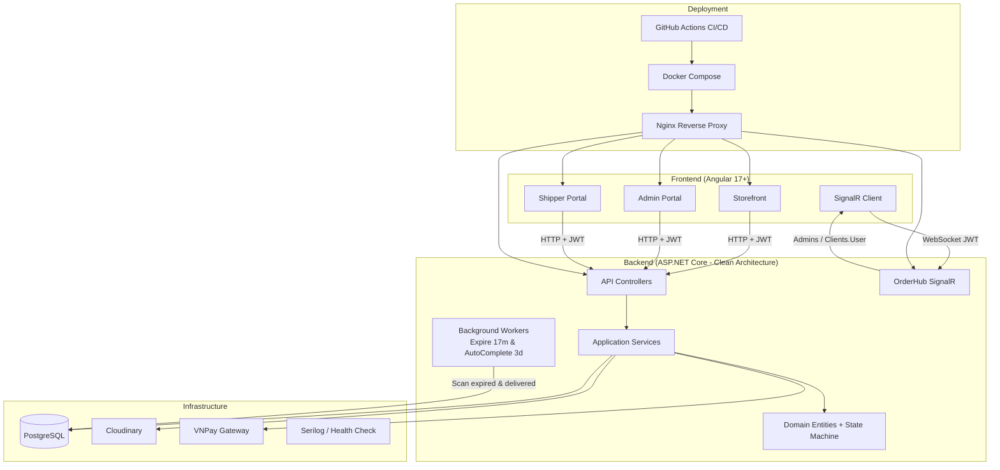
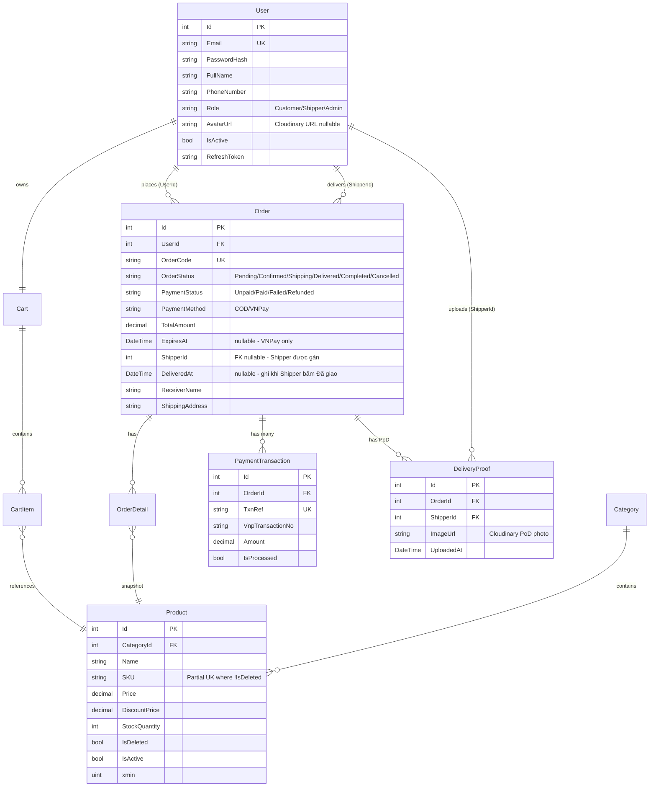

# 📋 Project Plan — VoltTech Store (Single-Vendor E-Commerce Platform)

> **Dự án:** Nền tảng thương mại điện tử Single-Vendor — VoltTech Store  
> **Tech Stack:** ASP.NET Core Web API · Angular 17+ · PostgreSQL · SignalR · VNPay · Cloudinary · Docker  
> **Phiên bản:** MVP 1.0 + Shipper Extension  
> **Thời gian:** 6 tuần

---

## 1. 🎯 Mục tiêu dự án

Xây dựng nền tảng thương mại điện tử hoàn chỉnh (**end-to-end**) theo mô hình Single-Vendor với 4 trụ cột kỹ thuật cốt lõi:

| # | Mục tiêu | Mô tả |
|---|----------|-------|
| 1 | **Tìm kiếm tốc độ cao** | Full-text search (`pg_trgm`) + Composite Index + bộ lọc đa tiêu chí trên 100k+ sản phẩm |
| 2 | **Toàn vẹn tồn kho & giao dịch** | Atomic Update chống bán âm kho (overselling) + tích hợp cổng VNPay chuẩn production (HMAC-SHA512 + `GET` IPN + Idempotency) |
| 3 | **Vòng đời giao hàng 2 chiều** | Phân công Shipper, upload ảnh PoD (Cloudinary), khách xác nhận nhận hàng + Auto-Complete sau 3 ngày |
| 4 | **Quản trị & Tác nghiệp thời gian thực** | Admin Dashboard + SignalR push notification phân tách theo vai trò (`Admins` group & `Clients.User`) < 1 giây |

### Đối tượng người dùng

| Đối tượng | Phạm vi thao tác |
|-----------|------------------|
| **Guest** | Xem, tìm kiếm, lọc sản phẩm, giỏ hàng lưu cục bộ (`localStorage`) |
| **Customer** | Gộp giỏ hàng DB, đặt hàng (COD/VNPay), thanh toán lại, theo dõi/hủy đơn, xác nhận đã nhận hàng, cập nhật hồ sơ |
| **Shipper** | Xem danh sách đơn được gán, nhận SignalR `OrderAssigned`, cập nhật `Shipping` và `Delivered` kèm upload ảnh PoD |
| **Admin** | Quản lý danh mục/sản phẩm/đơn hàng, gán Shipper, xem doanh thu và nhận SignalR đơn mới realtime |

---

## 2. 📊 KPI — Chỉ số thành công đo đạc được

| KPI | Mục tiêu | Phương pháp đo |
|-----|----------|----------------|
| **Hiệu năng tìm kiếm** | Độ trễ API tìm kiếm + lọc < **200ms (p95)** trên dataset ≥ 100.000 sản phẩm | k6 Load Test + `EXPLAIN ANALYZE` PostgreSQL |
| **Toàn vẹn tồn kho** | **0 lỗi bán âm kho** khi chạy đồng thời 20 request mua cùng 1 sản phẩm tồn kho = 1 | k6 Concurrency Test |
| **VNPay end-to-end** | **100%** quy trình VNPay Sandbox + `GET` IPN thành công với thẻ test hợp lệ | E2E Test tự động |
| **SignalR latency** | Độ trễ push thông báo đơn mới từ Server → Admin/Shipper < **1 giây** | Đo thực tế bằng timestamp |

---

## 3. 🔖 MVP Scope — Phạm vi tính năng

### ✅ Nằm trong MVP 1.0 + Shipper Extension

#### Storefront (Khách hàng)
- [ ] Trang chủ: Banner hero, danh mục nổi bật, sản phẩm mới/bán chạy
- [ ] Danh mục & tìm kiếm: RxJS `debounceTime(350)` + `distinctUntilChanged` + `switchMap` (hủy request cũ), bộ lọc đa tiêu chí (danh mục, khoảng giá, tồn kho, sắp xếp), phân trang
- [ ] Chi tiết sản phẩm: Thư viện ảnh, kiểm tra giới hạn tồn kho khi chọn số lượng
- [ ] Giỏ hàng: Đồng bộ `localStorage` (Guest) ↔ Server DB (Customer), gộp giỏ khi đăng nhập (`POST /api/cart/merge`)
- [ ] Checkout: Form giao hàng, 2 phương thức (**COD** + **VNPay**), redirect cổng thanh toán
- [ ] Kết quả thanh toán: Hiển thị trạng thái thực từ IPN, nút **Thanh toán lại** (nếu VNPay lỗi và còn trong 15 phút)
- [ ] Lịch sử đơn hàng: Xem + hủy đơn (khi `Pending` và `PaymentStatus ≠ Paid`) + nút **"Đã nhận hàng"** (khi `Delivered` → `Completed`)
- [ ] Trang tài khoản (`/account/profile`): Xem + cập nhật thông tin cá nhân, upload avatar Cloudinary *(ưu tiên thấp — có thể linh hoạt đẩy sang v2.0 nếu sát deadline Tuần 5)*

#### Shipper Portal (Nhân viên giao hàng)
- [ ] Màn hình danh sách đơn được gán (`/shipper/orders`): Lọc theo trạng thái, xem chi tiết địa chỉ & phương thức thu tiền (COD/Đã thanh toán)
- [ ] Bắt đầu giao: Nút **"Bắt đầu giao hàng"** chuyển `Confirmed → Shipping`
- [ ] Xác nhận giao: Nút **"Đã giao"** + dropzone **upload ảnh PoD** (1–5 ảnh, Cloudinary) → chuyển `Shipping → Delivered` (tự động `Paid` nếu COD)
- [ ] Nhận thông báo SignalR (`OrderAssigned`) khi Admin gán đơn mới

#### Admin Portal (Quản trị viên)
- [ ] Dashboard: 4 KPI cards + biểu đồ doanh thu (Chart.js) + bảng 5 đơn mới nhất
- [ ] CRUD Sản phẩm: Tìm kiếm/lọc, xóa mềm (`IsDeleted`), modal thêm/sửa + upload ảnh Cloudinary
- [ ] CRUD Danh mục: Thêm/sửa/xóa (**chặn xóa trả HTTP 400 nếu vẫn còn sản phẩm** — khớp BR-08)
- [ ] Quản lý đơn hàng: Lọc đa tiêu chí, cập nhật trạng thái theo State Machine, xem chi tiết VNPay, **gán Shipper cho đơn `Confirmed`**, xem ảnh PoD
- [ ] Thông báo SignalR: Toast realtime (`ReceiveNewOrder`) + chèn đơn mới vào bảng không cần F5

#### Backend & Hạ tầng
- [ ] Auth: JWT Access/Refresh Token, BCrypt, Role-based Authorization (3 roles DB: `Customer`, `Shipper`, `Admin` + `Guest` chưa đăng nhập)
- [ ] User Profile: `GET/PATCH /api/users/me`, `PATCH /api/users/me/avatar` (Cloudinary crop 1:1, max 2MB)
- [ ] Shipper API: `PATCH /api/orders/{id}/assign-shipper` (Admin), `PATCH /api/orders/{id}/start-shipping`, `PATCH /api/orders/{id}/delivered` (upload PoD Cloudinary + COD auto `Paid` + ownership check)
- [ ] Chống bán âm kho: Database Transaction + Atomic Update / Optimistic Concurrency (`xmin`), hoàn kho khi hủy đơn, sinh `OrderCode` an toàn đồng thời
- [ ] 2 Background Workers (`IHostedService`):
  - `OrderExpirationService`: Quét mỗi 1 phút, hủy đơn VNPay chưa thanh toán quá hạn **17 phút** (15p + 2p đệm) và hoàn kho
  - `AutoCompleteService`: Quét mỗi 1 giờ, tự động chuyển đơn `Delivered` quá **3 ngày** sang `Completed`
- [ ] VNPay IPN (`GET`): Xác thực HMAC-SHA512, `vnp_ExpireDate`, Idempotency check (`TxnRef`), cập nhật trạng thái
- [ ] SignalR `OrderHub`: JWT Auth, group `Admins` (`ReceiveNewOrder`) và `Clients.User` (`OrderAssigned`, `OrderDelivered`)
- [ ] Database: PostgreSQL, EF Core Code-First, Index tối ưu, Seed 2 chế độ (Demo 20 SP + Benchmark 100k SP)
- [ ] Docker & CI/CD: Multi-stage build, docker-compose, Nginx Reverse Proxy + SSL, GitHub Actions

### ❌ Lược bỏ khỏi MVP 1.0 (v2.0)
- Voucher / Mã giảm giá
- Redis Cache cho sản phẩm bán chạy
- Đánh giá sản phẩm (review/rating)
- Quên mật khẩu (forgot password flow)
- Cổng thanh toán MoMo, ZaloPay

---

## 4. 🏗️ Kiến trúc hệ thống

---

## 5. 🗂️ Database Schema — Quan hệ cốt lõi

### Index Strategy (đạt KPI < 200ms & tối ưu tác vụ nền)

| Index | Mục đích |
|-------|----------|
| `Composite (CategoryId, Price, IsDeleted)` trên `Products` | Bộ lọc đa tiêu chí |
| `GIN Index pg_trgm (Name)` trên `Products` | Tìm kiếm full-text thay thế `LIKE '%keyword%'` |
| `Partial Unique (SKU) WHERE IsDeleted = false` trên `Products` | Đảm bảo SKU không trùng giữa SP đang bán, hỗ trợ xóa mềm |
| `(UserId, CreatedAt DESC)` trên `Orders` | Lịch sử đơn hàng của khách |
| `(OrderStatus, ExpiresAt)` trên `Orders` | `OrderExpirationService` quét đơn VNPay quá hạn (BR-01) |
| `(OrderStatus, DeliveredAt)` trên `Orders` | `AutoCompleteService` quét đơn `Delivered` quá 3 ngày (BR-06) |

---

## 6. 📅 Lộ trình 6 tuần

### 🗓️ Tuần 1 — Foundation & Analysis

**Mục tiêu:** Chốt toàn bộ đặc tả, thiết kế DB & API, dựng môi trường

| Task | Mô tả | Deliverable |
|------|-------|-------------|
| Business Analysis | Chốt nghiệp vụ, State Machine, edge cases | `docs/business-rules.md` ✅ |
| ERD Design | Thiết kế đầy đủ quan hệ, đặt index & Partial Unique SKU | ERD diagram |
| API Spec | Định nghĩa toàn bộ endpoints RESTful (bao gồm Shipper & IPN `GET`) | OpenAPI/Swagger spec |
| Dev Environment | Khởi tạo Repo GitHub, Docker Compose PostgreSQL | `docker-compose.yml` |
| Project Structure | Khởi tạo Clean Architecture (.NET solution), Angular workspace | Repo structure |

**Definition of Done:** Repo có thể clone và chạy `docker compose up` → PostgreSQL healthy

---

### 🗓️ Tuần 2 — Backend Core

**Mục tiêu:** Backend fully functional với Auth, Catalog, Profile, Seed data

| Task | Mô tả | Deliverable |
|------|-------|-------------|
| Auth Module | JWT Access/Refresh (chứa `NameIdentifier` & `Role`), BCrypt, Role-based | `/api/auth/*` endpoints |
| User Profile API | `GET/PATCH /api/users/me` + `PATCH /api/users/me/avatar` (Cloudinary) | `/api/users/*` endpoints |
| Catalog Module | CRUD Category (chặn xóa nếu còn SP) + Product (soft delete), Cloudinary | `/api/categories/*`, `/api/products/*` |
| Cart Module Backend | Giỏ hàng DB + endpoint gộp giỏ `POST /api/cart/merge` | `/api/cart/*` endpoints |
| EF Core + Migrations | Code-First entities, FK, toàn bộ Index tối ưu | Migration files |
| Seed Data | Demo Mode (20 SP + tài khoản Admin/Shipper/Customer) + Benchmark Mode (100k SP với Bogus) | Seeder scripts |
| Search API | Tìm kiếm + lọc đa tiêu chí tối ưu, kiểm chứng `EXPLAIN ANALYZE` | `GET /api/products` |

**Definition of Done:** `GET /api/products?searchTerm=xxx&categoryId=1&minPrice=100` trả về < 200ms (p95) trên 100k SP

---

### 🗓️ Tuần 3 — Storefront Frontend (Cốt lõi)

**Mục tiêu:** Angular Storefront hoàn chỉnh cho Guest & Customer trước bước đặt hàng

| Task | Mô tả | Deliverable |
|------|-------|-------------|
| Project Setup | Angular standalone components, routing, lazy loading | App shell |
| Auth Pages (M01–M02) | Đăng nhập, đăng ký, `AuthInterceptor`, `AuthGuard`, `AdminGuard`, `ShipperGuard` | Auth module |
| Home Page (M04) | Hero banner, danh mục nổi bật, `ProductCardComponent` | `HomeComponent` |
| Catalog & Filter (M05) | RxJS pipeline tìm kiếm (`debounceTime` → `distinctUntilChanged` → `switchMap`), sidebar lọc | `ProductCatalogComponent` |
| Product Detail (M06) | Chi tiết sản phẩm, bộ chọn số lượng có kiểm tra giới hạn tồn kho | `ProductDetailComponent` |
| Cart Module (M07) | `CartService` (Angular Signals), đồng bộ `localStorage` và gộp giỏ hàng (`POST /api/cart/merge`) | `CartComponent`, `CartService` |

**Definition of Done:** Luồng hoàn chỉnh từ trang chủ → tìm kiếm → chi tiết → giỏ hàng (cả Guest lẫn Customer + gộp giỏ khi đăng nhập)

---

### 🗓️ Tuần 4 — Order, VNPay, SignalR & Shipper Backend

**Mục tiêu:** Hoàn thiện trọn bộ nghiệp vụ đơn hàng, thanh toán, giao vận Backend và luồng mua hàng Frontend

| Task | Mô tả | Deliverable |
|------|-------|-------------|
| Order Module Backend | Tạo đơn (COD + VNPay), trừ kho atomic, hoàn kho khi hủy, Price Snapshot, `OrderCode` an toàn đồng thời | `POST /api/orders`, `PATCH .../cancel`, `PATCH .../complete` |
| Shipper & PoD Backend | API `assign-shipper`, `start-shipping`, `delivered` (upload PoD Cloudinary + tự động `Paid` cho COD), ownership check | `/api/orders/{id}/*` |
| Background Workers | `OrderExpirationService` (quét đơn VNPay quá 17p) và `AutoCompleteService` (quét đơn `Delivered` quá 3 ngày) | 2 `IHostedService` |
| VNPay Integration | Sinh URL kèm `vnp_ExpireDate` & HMAC-SHA512, `GET` Return URL, `GET` IPN (Idempotency), API `repay` | `/api/payments/vnpay/*` |
| SignalR Hub | `OrderHub` với JWT Auth, group `Admins` (`ReceiveNewOrder`) và `Clients.User` (`OrderAssigned`, `OrderDelivered`) | `OrderHub` |
| Storefront Checkout & Orders | `CheckoutComponent` (M08), `PaymentCallbackComponent` (M09), `OrderHistoryComponent` (M10 + nút Hủy / Thanh toán lại / Đã nhận hàng) | Checkout & Order UI |

**Definition of Done:** Luồng COD và VNPay Sandbox hoạt động trọn vẹn (IPN `GET` → `Paid + Confirmed` → bắn SignalR < 1 giây); Shipper API test pass qua Swagger/Postman

---

### 🗓️ Tuần 5 — Admin Portal, Shipper Portal, Profile & Testing

**Mục tiêu:** Hoàn thiện giao diện quản trị/giao hàng + toàn bộ kiểm thử đạt KPI

| Task | Mô tả | Deliverable |
|------|-------|-------------|
| Admin Portal (M11–M14) | Dashboard Chart.js + SignalR Toast, CRUD Products/Categories, Order Manage (State Machine, gán Shipper, xem ảnh PoD) | Admin module |
| Shipper Portal (M15) | `/shipper/orders`: danh sách đơn được gán, nhận Toast SignalR, bấm `Shipping` / `Delivered` + dropzone upload PoD | `ShipperOrdersComponent` |
| Account Profile (M10b) | `/account/profile`: sửa thông tin cá nhân, upload avatar Cloudinary *(ưu tiên thấp — linh hoạt lùi v2.0 nếu gấp)* | `AccountProfileComponent` |
| Unit Tests (BE & FE) | xUnit + Moq (State Machine, tính tiền, HMAC-SHA512, IPN Idempotency, Shipper ownership) + Jasmine/Jest (`CartService`) | Test projects |
| Performance & Concurrency | k6 đo p95 tìm kiếm < 200ms trên 100k SP + k6 bắn 20 request đồng thời mua SP tồn kho = 1 (0 âm kho) | k6 scripts & report |
| Security Test | Kiểm tra CORS, SQL Injection, giả mạo chữ ký VNPay IPN, cách ly SignalR giữa Customer/Shipper/Admin | Security checklist |

**Definition of Done:** Tất cả Unit Tests pass + k6 xác nhận KPI tìm kiếm < 200ms và 0 overselling

---

### 🗓️ Tuần 6 — Docker, CI/CD & Deployment

**Mục tiêu:** Hệ thống đóng gói chuẩn production, tự động hóa kiểm thử và sẵn sàng demo

| Task | Mô tả | Deliverable |
|------|-------|-------------|
| Backend Dockerfile | Multi-stage: `dotnet/sdk` build → `dotnet/aspnet` run | `Dockerfile` |
| Frontend Dockerfile | Multi-stage: `node:alpine` build → `nginx:alpine` serve | `Dockerfile` |
| docker-compose.yml | Orchestrate: `backend-api`, `frontend-web`, `postgres-db` | `docker-compose.yml` |
| Nginx Config | Reverse Proxy + WebSocket upgrade cho `/orderHub` + SSL | `nginx.conf` |
| SSL / HTTPS | Let's Encrypt + Certbot | Certs |
| CI/CD Pipeline | GitHub Actions: `dotnet test` + `ng test --watch=false` + Docker build | `.github/workflows/ci.yml` |
| Monitoring & Backup | Serilog structured logging, `/health` endpoint, Cronjob `pg_dump` daily + tài liệu `pg_restore` | Ops scripts |
| Integration E2E | 4 kịch bản: VNPay OK + Shipper giao + Customer chốt; COD + Shipper giao auto Paid; VNPay lỗi + Thanh toán lại; Timeout 17p hoàn kho | E2E report |

**Definition of Done:** `docker compose up` → healthy → E2E pass → CI/CD xanh

---

## 7. 🧱 Module Checklist tổng hợp

### Backend Modules

- [ ] **Auth & Identity** — Đăng ký/đăng nhập/đăng xuất, JWT (`NameIdentifier` + `Role`), BCrypt, Refresh Token (`Customer` / `Shipper` / `Admin`)
- [ ] **User Profile & Avatar** — `GET/PATCH /api/users/me`, upload avatar Cloudinary (`/users/avatars`, crop 1:1, max 2MB)
- [ ] **Catalog** — CRUD Category (chặn xóa còn SP) + Product (soft delete, Partial Unique SKU), Cloudinary, Search/Filter API
- [ ] **Cart & Order** — Giỏ hàng Server, gộp giỏ, tạo đơn (COD/VNPay), Price Snapshot, Atomic Stock + hoàn kho khi hủy, `OrderCode` an toàn đồng thời
- [ ] **Shipper Module** — `assign-shipper`, `start-shipping`, `delivered` (upload PoD Cloudinary + auto `Paid` cho COD), ownership check
- [ ] **Payment VNPay** — Sinh URL (`vnp_ExpireDate`), `GET` Return URL, `GET` IPN webhook, Idempotency (`TxnRef`), `repay`
- [ ] **SignalR Hub** — `OrderHub`, JWT auth, group `Admins` (`ReceiveNewOrder`) và `Clients.User` (`OrderAssigned`, `OrderDelivered`)
- [ ] **Background Workers** — `OrderExpirationService` (quét đơn VNPay quá 17p) & `AutoCompleteService` (quét đơn `Delivered` quá 3 ngày)
- [ ] **Analytics** — Doanh thu theo ngày/tháng/năm (dựa trên Price Snapshot), Top 5/10 SP, KPI cards
- [ ] **Infrastructure** — Serilog, Health Check, Docker, Nginx, CI/CD

### Frontend Modules

- [ ] **Auth** — M01 Login, M02 Register, `AuthInterceptor`, `AuthGuard`, `AdminGuard`, `ShipperGuard`
- [ ] **Storefront** — M04 Home, M05 Catalog+Filter (RxJS `switchMap`), M06 Product Detail
- [ ] **Cart & Checkout** — M07 Cart (Signals + Merge), M08 Checkout (COD/VNPay), M09 Callback (Thanh toán lại), M10 Order History (Hủy đơn + Xác nhận đã nhận hàng)
- [ ] **Account** — M10b Profile (xem/sửa thông tin, upload avatar Cloudinary, fallback initials)
- [ ] **Shipper Portal** — M15 Danh sách đơn được gán, SignalR Toast, bấm Bắt đầu giao / Đã giao + upload PoD
- [ ] **Admin Portal** — M11 Dashboard, M12 Products, M13 Categories, M14 Orders (gán Shipper, xem PoD), SignalR Notification

---

## 8. 🔮 Roadmap v2.0 (sau MVP)

| Feature | Mô tả | Pattern |
|---------|-------|---------|
| Hệ thống Voucher | Mã giảm giá theo %, fix amount, điều kiện | — |
| MoMo / ZaloPay | Thêm cổng thanh toán | `IPaymentService` Strategy Pattern |
| Redis Cache | Cache danh sách sản phẩm bán chạy | Cache-aside |
| Đánh giá sản phẩm | Review + Rating với kiểm duyệt | — |
| Quên mật khẩu | Email link reset password | — |
| Elasticsearch | Tìm kiếm nâng cao (typo-tolerance, suggestions) | — |